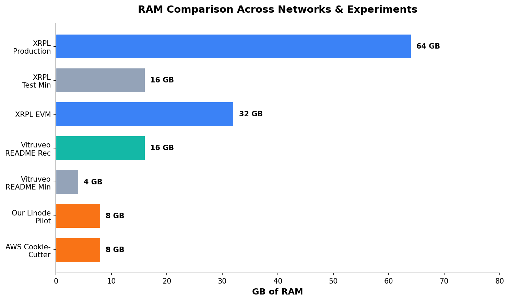
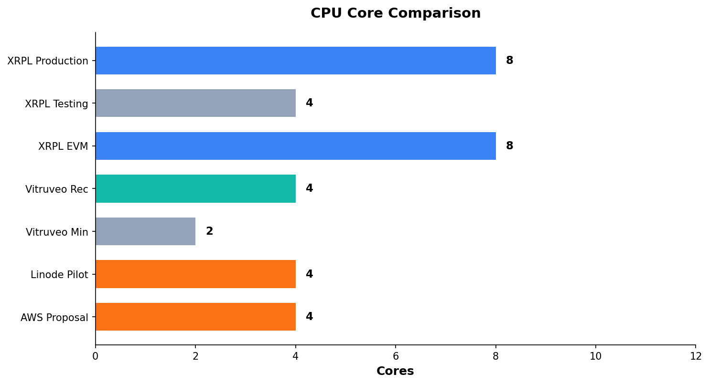
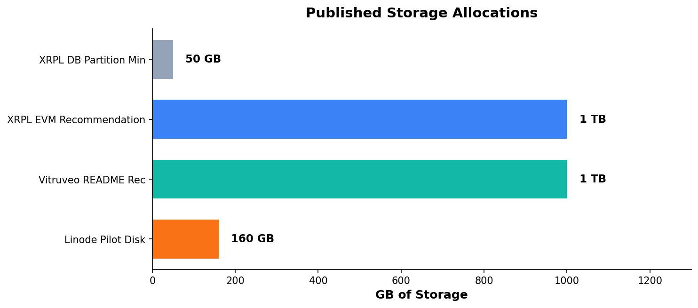

# Blockchain Node Infrastructure Comparison

**Production Planning Comparison · November 24, 2026**  
XRPL · XRPL EVM · Vitruveo

---

## Color Key — Node Roles

These colors mean the same thing across all three networks. A machine can perform more than one role.

| Color | Role | Description |
|-------|------|-------------|
| **Blue** | Full / Tracking Node | Follows the blockchain, processes blocks and maintains current state. |
| **Purple** | Validator | Participates in consensus and signs or publishes validations. |
| **Green** | API / RPC | Serves applications and users querying the blockchain. |
| **Orange** | Archive / Historical | Retains historical ledger or state data. |
| **Grey** | Seed / Bootnode | Helps other machines discover and connect to peers. |
| **Teal** | Sentry | Protects validator infrastructure by managing external peer connections. |

---

## XRPL Mainnet

Published production recommendations for the core server and Clio.

| Node Type | Color | CPU | RAM | Storage |
|-----------|-------|-----|-----|---------|
| Tracking / Stock | Blue | 8+ cores | 64 GB | Fast SSD |
| Validator | Purple | 8+ cores | 64 GB | Fast SSD |
| Clio API | Green | 8+ cores | 64 GB | Fast SSD |
| Historical | Orange | Workload dependent | 64 GB baseline | Multiple TB possible |

**Official production baseline**
- 8+ CPU cores (3 GHz+)
- 64 GB RAM
- SSD/NVMe with 10,000 sustained IOPS
- 50 GB minimum database partition
- 1 Gbps network

The XRPL documentation explicitly warns that the 16 GB / 4-core minimum is **not** sufficient to reliably stay synchronized with Mainnet.

> Even an ordinary XRPL tracking node has a substantial production hardware recommendation. It isn’t just the validators that need good hardware.

---

## XRPL EVM

General EVM node recommendations. Current Mainnet release: v11.3.0 (upgraded October 29, 2026).

| Node Type | Color | CPU | RAM | Storage |
|-----------|-------|-----|-----|---------|
| Full node | Blue | 8 physical cores | 32 GB | 1 TB |
| Validator | Purple | 8 physical cores | 32 GB | 1 TB |
| RPC / API | Green | 8 physical cores | 32 GB | 1 TB |
| Archive | Orange | Workload dependent | 32 GB baseline | More than 1 TB possible |
| Seed / Sentry | Grey / Teal | Workload dependent | Workload dependent | Workload dependent |

**Published baseline**
- 8 physical CPU cores
- 32 GB RAM
- 1 TB SSD/NVMe
- 100 Mbps network
- Linux AMD64 (ARM64 binaries also available)

These are general recommendations, not separate independently published minimums for each role.

---

## Vitruveo — Confirmed Baseline

Modified Geth implementation. Not the same as running a standard Ethereum Mainnet node.

| Item | Confirmed Configuration |
|------|-------------------------|
| Client | Vitruveo Geth fork |
| Geth version | 1.13.15-stable |
| Build commit | 79306d56df802b154e8d949fe32d970f9d8896ab |
| Chain ID | 1490 |
| Consensus | Clique PoA |
| Merge | Not enabled |
| Shanghai | Block 0 |
| OS on pilot | Ubuntu 24.04 |
| Snapshot | ~4.5 GB at block 5,429,695 |

### Repository Guidance (Vitruveo Geth README)

| Resource | Minimum | Recommended |
|----------|---------|-------------|
| CPU | 2+ cores | 4+ fast cores |
| RAM | 4 GB | 16 GB+ |
| Free storage | 1 TB | 1 TB fast SSD |
| Download bandwidth | 8 Mbps | 25 Mbps+ |

These figures are inherited Geth-style guidance. They are a starting specification, **not** a demonstrated production validator benchmark for Vitruveo.

---

## What We Have Actually Tested

### Linode Pilot — Read-Only Experiment
**Not an accepted validator**

- 4 shared vCPU
- 8 GB RAM
- 160 GB SSD
- 4.5 GB imported snapshot

**Status**
- Snapshot successfully extracted
- Local Geth build completed
- Chain ID verified
- Local block database loaded
- Archive mode was specified (`--syncmode full --gcmode archive`)
- Peer discovery and sustained synchronization were **not** yet proven
- No validator signing was configured

### AWS Cookie-Cutter Proposal
Proposed configuration — **not** a verified production benchmark.

| Resource | Proposed |
|----------|----------|
| Instance | c6i.xlarge |
| CPU | 4 vCPU |
| RAM | 8 GiB |
| OS | Ubuntu 24.04 |
| Estimated cost | ~$140/month before storage |

This configuration is below the repository’s own recommended 16 GB RAM and 1 TB SSD. Disk allocation for an archive configuration has not been established.

---

## Hardware Comparison Charts

### RAM Comparison

*GB of RAM. Published recommendations vs. experiments.*

### CPU Comparison

Four shared vCPUs do not guarantee four continuously available physical cores.

### Storage Comparison

XRPL’s 50 GB figure is only a minimum database partition, not a full historical archive. The 1 TB recommendations are allocations, not guarantees that an archive will fit.

---

## Archive Mode vs. Validator Mode

These are two different questions:

1. **What job does the node perform?**  
   Read-only · Validator · API · Peer discovery

2. **What blockchain data does it retain?**  
   Pruned/full current state **or** historical archive

An archive node isn’t automatically a validator. A read-only node can be an archive node.

Our Vitruveo build is Geth 1.13.15. It predates the newer path-based archive storage. Older hash-based archive mode on Ethereum Mainnet can exceed 20 TB. We should not assume modern Geth archive figures apply, nor simply apply Ethereum’s numbers to Vitruveo.

> The 4.5 GB snapshot is only the size of that particular database at that particular block. It is **not** an indication of the eventual disk requirement.

---

## Proposed Planning Targets for Vitruveo

These are planning targets, **not** official Vitruveo hardware specifications.

| Role | Color | CPU | RAM | Storage | Notes |
|------|-------|-----|-----|---------|-------|
| Read-only Full Node | Blue | 4–8 dedicated cores | 16 GB | 1 TB NVMe | Planning baseline, without full historical archive retention |
| Validator | Purple | 8 dedicated cores | 16–32 GB | 1 TB+ NVMe | Conservative target pending actual validator performance testing |
| Archive Node | Orange | 8+ dedicated cores | 32 GB | 2 TB+ NVMe | Provisional budget. Actual archive growth must be measured |

Not all 35 proposed validators need to operate as archive nodes. Historical archive services can be provided separately.

---

## Summary & Recommendation

1. XRPL’s published production recommendation is **64 GB RAM and 8+ cores**.
2. XRPL EVM’s published recommendation is **32 GB RAM and 8 physical cores**.
3. Vitruveo’s published Geth recommendation is **16 GB RAM, 4+ fast cores and 1 TB SSD** — this is not a demonstrated production validator benchmark.
4. Current 4-vCPU / 8 GB experiments are useful proof-of-concept machines. They should **not** become the assumed production standard without further testing.

### Strongest Recommendation

Before deploying the cookie-cutter image to all 35 validators, establish a **hardware qualification test** with:

- The actual software and snapshot
- Peer configuration
- Validator workload

Also run one separate archive experiment to measure real disk growth.

Measure:
- Peak and sustained CPU usage
- Peak RAM usage during synchronization and normal operation
- Database growth per day and per million blocks
- NVMe read/write latency and IOPS
- Peer count and synchronization lag
- Validator signing and block-production reliability
- Performance under restart and recovery

That gives evidence instead of guessing, and prevents provisioning 35 machines that may all need to be upgraded later.

---

*Sources: XRPL documentation, XRPL EVM documentation, Vitruveo Geth repository, and recorded experiments (Linode pilot + AWS proposal).*
